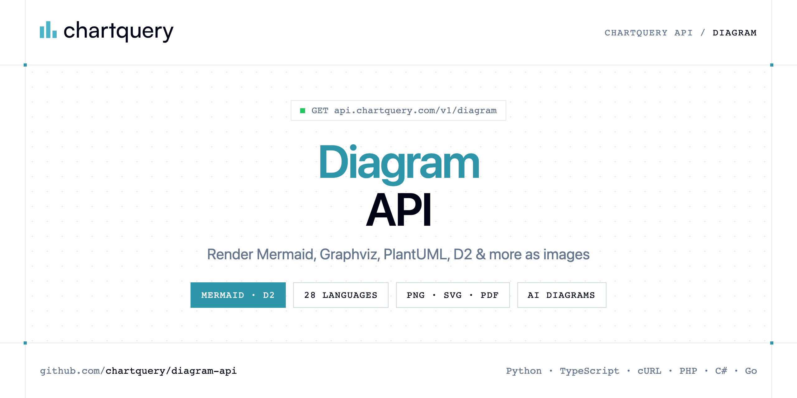

<p align="center">
  <a href="https://www.chartquery.com"></a>
</p>

# Diagram API

[](https://discord.gg/CFj3ph8aHU) [](https://app.chartquery.com/register) [](https://app.chartquery.com/openapi) [](LICENSE)

The **ChartQuery Diagram API** renders diagram-as-code (Mermaid, Graphviz, PlantUML, D2 and 24 other languages) to PNG, SVG, JPEG or PDF — or generates a diagram from a plain-English prompt.

- **Diagram Render API** — Render a diagram via GET.
- **AI Diagram API** — Describe a diagram in plain English via GET and get a rendered image back.

Use it for docs, READMEs, wikis, architecture diagrams and AI assistants.

| Endpoint | Request | Credits |
|---|---|---|
| [Diagram Render API](#diagram-render-api) | `GET /v1/diagram` | 5 |
| [AI Diagram API](#ai-diagram-api) | `GET /v1/diagram/ai` | 10 |

## Table of contents

- [How it works](#how-it-works)
- [Diagram Render API](#diagram-render-api)
- [AI Diagram API](#ai-diagram-api)
- [Code examples in other languages](#code-examples-in-other-languages)
- [Use cases](#use-cases)
- [Why ChartQuery?](#why-chartquery)
- [FAQ](#faq)
- [Official SDKs](#official-sdks)
- [Related repositories](#related-repositories)
- [Support](#support)

## How it works

1. **Create a ChartQuery account** and copy your API key from the [dashboard](https://app.chartquery.com/register).
2. **Call `https://api.chartquery.com`** with the header `x-api-key: YOUR_API_KEY`.
3. **Use the result** in your app — no infrastructure to run.

```bash
export CHARTQUERY_API_KEY="your-api-key"
pip install requests        # Python
# TypeScript: Node.js 18+ (native fetch), run with `npx tsx file.ts`
```

## Diagram Render API

Render a diagram via GET. Use type (mermaid, d2, …), query (source code), and format=png for ChatGPT. POST uses diagram_type and diagram_source instead.

`GET https://api.chartquery.com/v1/diagram` · **5 credits per request** · [API reference](https://app.chartquery.com/openapi)

### Request parameters

| Parameter | In | Type | Required | Description |
|---|---|---|---|---|
| `type` | query | string (`mermaid`, `graphviz`, `plantuml`, `d2`, `svgbob`, `nomnoml`) | ✅ | Diagram language. |
| `query` | query | string | ✅ | Diagram source code (URL-encoded). |
| `format` | query | string (`svg`, `png`, `jpeg`, `pdf`) | — | Use png so ChatGPT can display the image. svg is for download or infinite scale. |
| `share` | query | boolean | — | If true, persist the result and return share URLs instead of an image. Leave false to get the image. |

### Python example

```python
import os

import requests

API_KEY = os.environ["CHARTQUERY_API_KEY"]
HEADERS = {"x-api-key": API_KEY}

response = requests.get(
    "https://api.chartquery.com/v1/diagram",
    headers=HEADERS,
    params={
        "type": "mermaid",
        "query": "graph TD\n  A[Start] --> B{OK?}\n  B -->|yes| C[End]\n  B -->|no| D[Error]",
        "format": "png",
    },
    timeout=120,
)
response.raise_for_status()

with open("diagram.png", "wb") as f:
    f.write(response.content)
print("Saved diagram.png", len(response.content), "bytes")
```

### TypeScript example

```typescript
import { writeFile } from "node:fs/promises";

const headers = { "x-api-key": process.env.CHARTQUERY_API_KEY!, "Content-Type": "application/json" };

const params = new URLSearchParams({
  "type": "mermaid",
  "query": "graph TD\n  A[Start] --> B{OK?}\n  B -->|yes| C[End]\n  B -->|no| D[Error]",
  "format": "png",
});

const response = await fetch(`https://api.chartquery.com/v1/diagram?${params}`, { headers });
if (!response.ok) throw new Error(`HTTP ${response.status}: ${await response.text()}`);

await writeFile("diagram.png", Buffer.from(await response.arrayBuffer()));
console.log("Saved diagram.png");
```

### Output

The response body is the generated file (saved as `diagram.png` in every example). Error responses are JSON with an explanatory message.

## AI Diagram API

Describe a diagram in plain English via GET and get a rendered image back. Powered by AI.

`GET https://api.chartquery.com/v1/diagram/ai` · **10 credits per request** · [API reference](https://app.chartquery.com/openapi)

### Request parameters

| Parameter | In | Type | Required | Description |
|---|---|---|---|---|
| `prompt` | query | string | ✅ | Describe your diagram in plain English (max 1000 chars). Be specific: mention the diagram type, key entities, and relationships. |
| `diagram_type` | query | string (`mermaid`, `d2`, `plantuml`, `graphviz`) | — | Preferred diagram language. AI chooses if omitted. Examples: "mermaid", "d2", "plantuml", "graphviz". |
| `output_format` | query | string (`svg`, `png`, `jpeg`, `pdf`) | — | Output format. Default: "svg". |
| `share` | query | boolean (`false`, `true`) | — | Set share=true to persist the config and receive JSON instead of an image: { id, render_url, view_url, embed_url, expires_in }. Free plan: 3-day expiry. Paid plan: 6-month expiry. |

### Python example

```python
import os

import requests

API_KEY = os.environ["CHARTQUERY_API_KEY"]
HEADERS = {"x-api-key": API_KEY}

response = requests.get(
    "https://api.chartquery.com/v1/diagram/ai",
    headers=HEADERS,
    params={
        "prompt": "Sequence diagram of a user logging in through an API gateway to an auth service",
        "output_format": "png",
    },
    timeout=120,
)
response.raise_for_status()

with open("ai-diagram.png", "wb") as f:
    f.write(response.content)
print("Saved ai-diagram.png", len(response.content), "bytes")
```

### TypeScript example

```typescript
import { writeFile } from "node:fs/promises";

const headers = { "x-api-key": process.env.CHARTQUERY_API_KEY!, "Content-Type": "application/json" };

const params = new URLSearchParams({
  "prompt": "Sequence diagram of a user logging in through an API gateway to an auth service",
  "output_format": "png",
});

const response = await fetch(`https://api.chartquery.com/v1/diagram/ai?${params}`, { headers });
if (!response.ok) throw new Error(`HTTP ${response.status}: ${await response.text()}`);

await writeFile("ai-diagram.png", Buffer.from(await response.arrayBuffer()));
console.log("Saved ai-diagram.png");
```

### Output

The response body is the generated file (saved as `ai-diagram.png` in every example). Error responses are JSON with an explanatory message.

## Code examples in other languages

Ready-to-run examples live in [`examples/`](examples); each reads your key from `CHARTQUERY_API_KEY`.

| Language | `diagram` | `diagram-ai` |
|---|---|---|
| cURL (Bash) | [diagram.sh](examples/curl/diagram.sh) | [diagram_ai.sh](examples/curl/diagram_ai.sh) |
| PHP | [diagram.php](examples/php/diagram.php) | [diagram_ai.php](examples/php/diagram_ai.php) |
| C# | [Diagram.cs](examples/csharp/Diagram.cs) | [DiagramAi.cs](examples/csharp/DiagramAi.cs) |
| Go | [diagram.go](examples/go/diagram.go) | [diagram_ai.go](examples/go/diagram_ai.go) |
| Java | [DiagramExample.java](examples/java/DiagramExample.java) | [DiagramAiExample.java](examples/java/DiagramAiExample.java) |
| Ruby | [diagram.rb](examples/ruby/diagram.rb) | [diagram_ai.rb](examples/ruby/diagram_ai.rb) |
| Node.js | [diagram.mjs](examples/nodejs/diagram.mjs) | [diagram_ai.mjs](examples/nodejs/diagram_ai.mjs) |

## Use cases

- **Documentation** — Render diagrams for docs and wikis on the fly.
- **Architecture** — Keep diagrams as code and render them in CI.
- **AI assistants** — Let agents draw flowcharts and sequence diagrams.

## Why ChartQuery?

- **Images in one request** — the response body is the PNG/SVG/PDF, ready for emails, PDFs, dashboards, Slack or `` tags.
- **Charts, diagrams, QR codes, barcodes, labels** — Chart.js configs, 28 diagram languages (Mermaid, Graphviz, PlantUML, D2…), 25+ barcode formats.
- **AI generation** — describe a chart or diagram in plain English and get the rendered image.
- **No rendering infrastructure** — no headless browser, fonts or libraries to maintain.
- **Copy-paste examples** — Python and TypeScript in each README, 7 more languages in `examples/`.

## FAQ

### How do I authenticate?

Create an account on [ChartQuery](https://app.chartquery.com/register), copy your API key and send it in the `x-api-key` header of every request to `https://api.chartquery.com`.

### How much does a request cost?

Credits per call: `/v1/diagram` **5**, `/v1/diagram/ai` **10**. See [ChartQuery pricing](https://www.chartquery.com/pricing).

### What does the API return?

The response body is the file itself (image or document). Save it directly to disk or stream it to your storage — every example in this repository writes the file locally.

### Which diagram languages are supported?

mermaid, graphviz, plantuml, d2, svgbob, nomnoml, blockdiag, seqdiag, actdiag, nwdiag, bpmn, erd, excalidraw, ditaa, vega, vegalite, wavedrom, wireviz, c4plantuml, structurizr, tikz, pikchr, umlet, symbolator, packetdiag, rackdiag, bytefield and dbml.

### Which languages are supported?

Any language that can make an HTTP request. This README shows Python and TypeScript; the [`examples/`](examples) folder contains cURL, PHP, C#, Go, Java, Ruby and Node.js.

## Official SDKs

Use ChartQuery from your own language with a typed client:

| SDK | Package | Install |
| --- | --- | --- |
| Node.js | [`@chartquery/sdk`](https://www.npmjs.com/package/@chartquery/sdk) | `npm install @chartquery/sdk` |
| Python | [`chartquery`](https://pypi.org/project/chartquery/) | `pip install chartquery` |
| Go | [`chartquery-go`](https://pkg.go.dev/github.com/chartquery/chartquery-go) | `go get github.com/chartquery/chartquery-go` |
| .NET | [`ChartQuery`](https://www.nuget.org/packages/ChartQuery) | `dotnet add package ChartQuery` |
| Ruby | [`chartquery`](https://rubygems.org/gems/chartquery) | `gem install chartquery` |
| PHP | [`chartquery/sdk`](https://packagist.org/packages/chartquery/sdk) | `composer require chartquery/sdk` |
| Java | [`chartquery-java`](https://github.com/chartquery/chartquery-java) | build from source, see its README |
| CLI | [`@chartquery/cli`](https://www.npmjs.com/package/@chartquery/cli) | `npm install -g @chartquery/cli` |
| MCP server | [`@chartquery/mcp`](https://www.npmjs.com/package/@chartquery/mcp) | `npx -y @chartquery/mcp` |

## Related repositories

- [Chart API](https://github.com/chartquery/chart-api)
- [QR Code API](https://github.com/chartquery/qr-code-api)
- [Barcode API](https://github.com/chartquery/barcode-api)
- [Thermal Label API](https://github.com/chartquery/thermal-label-api)
- [All ChartQuery repositories](https://github.com/chartquery)

## Support

- 💬 Join the [Discord](https://discord.gg/CFj3ph8aHU) to ask questions and share what you build.
- 📚 Read the [API reference](https://app.chartquery.com/openapi).
- 🔑 [Get your API key](https://app.chartquery.com/register).

---

<p align="center">
  <a href="https://www.chartquery.com">
    <picture>
      <source media="(prefers-color-scheme: dark)" srcset="images/logo-dark.svg">
      
    </picture>
  </a>
  <br>
  <sub>Built by <a href="https://www.chartquery.com">ChartQuery</a>. Examples are released under the MIT license.</sub>
</p>
